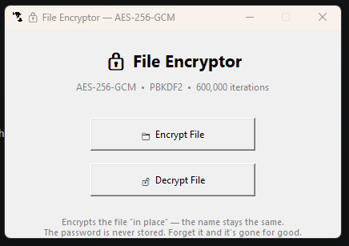

# File Encryptor — AES-256-GCM

A simple desktop app that encrypts any file **in place** — no extra `.enc` copies, no clutter. Just pick a file, set a password, and it's locked down with modern, military-grade encryption.

## Features

-  **AES-256-GCM** — authenticated encryption (protects against both reading *and* tampering)
-  **Password-based** — no key files to lose, the key is derived from your password every time
-  **PBKDF2 with 600,000 iterations** — makes brute-force password guessing painfully slow
-  **Unique random salt per file** — same password never produces the same key twice
-  **In-place encryption** — file name and extension never change, only the content
-  **Atomic writes** — if the process is interrupted, your original file is never left half-written or corrupted
-  **Simple GUI** — built with Tkinter, no extra dependencies beyond `cryptography`

## 📸 Screenshot



## Getting Started

### Requirements

- Python 3.8+
- [`cryptography`](https://pypi.org/project/cryptography/) library

### Installation

```bash
git clone https://github.com/yourusername/file-encryptor.git
cd file-encryptor
python -m pip install cryptography
```

### Usage

```bash
python file_encryptor.py
```
Click **Encrypt File**, choose a file, set a password
The file is encrypted in place — nothing new is created
Click **Decrypt File**, choose the same file, enter the password
The original content is restored
